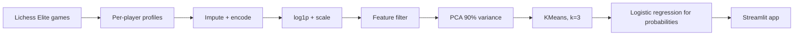

# ♞ ChessDNA : Chess Player Style Analyser

Predict a chess player's **playing style** from their average game statistics. Pick a sample player or set the sliders yourself, and the app returns the style, how close the player sits to each style, and a radar chart comparing the player with the typical player of that style.

**Live demo:** https://ai-chess-player-style-analyser.onrender.com *(free tier: the first visit after idle takes about a minute to wake)*

## The three styles

| Style | What defines it |
|---|---|
| ♞ **Tactical attacker** | Most checks and sacrifices; castles early |
| ♛ **Early-queen risk-taker** | Brings the queen out early; castles late; highest capture rate |
| ♟ **Quiet / positional** | Fewest checks and sacrifices; most pawn moves |

## How it works



- **Data:** Lichess Elite Database (Oct 2025). 5,000 games were sampled and each was replayed move by move with `python-chess` to compute behavioural features, then averaged per player. This gives 1,112 players with 3 or more games.
- **Features:** capture rate, checks, castling move, development speed, early queen moves, pawn-move ratio, sacrifices, plus opening family and time control.
- **Leak-free preprocessing:** the train/test split (80/20) happens before any imputer, encoder, scaler, filter or PCA is fitted.
- **Feature reduction:** 14 features, then 11 after removing near-constant ones, then 7 PCA components.
- **Model:** KMeans with 3 clusters. Logistic regression is trained on the cluster labels so a new player gets a probability for each style.

## Results

| Metric | Value |
|---|---|
| Silhouette score (train / test) | 0.133 / 0.100 |
| Cluster sizes (train) | 298 / 316 / 275 |
| Classifier agreement with KMeans (test) | 97.8% accuracy, 97.8% macro-F1 |

## Limitations

- Silhouette scores are low: playing style is a **continuum**, so the groups overlap. An average player still gets a label.
- The percentages show distance to a style boundary, not certainty.
- The 97.8% only means the classifier reproduces KMeans' boundaries. There are no ground-truth style labels.
- The data is an elite blitz pool, so features such as time control and castling habit hardly vary.

## Project structure

```
app.py                  Streamlit app (UI + prediction)
style_model.joblib      Fitted preprocessing + PCA + KMeans + classifier
requirements.txt        Pinned versions (must match the model file)
.streamlit/config.toml  Theme
```

The model was trained in the project notebook. `style_model.joblib` stores the fitted pipeline, so the app never refits anything.

## Run locally

```bash
pip install -r requirements.txt
streamlit run app.py
```

Use Python 3.12 or newer. The pinned numpy version requires it.

## Deploy on Render

1. Push this repo to GitHub.
2. Render: **New +**, then **Web Service**, then connect the repo.
3. Runtime `Python 3`. Build command: `pip install -r requirements.txt`
4. Start command: `streamlit run app.py --server.port $PORT --server.address 0.0.0.0 --server.headless true`
5. Add the environment variable `PYTHON_VERSION` = `3.12.8`.
   

## Credits

Data: [Lichess Elite Database](https://database.nikonoel.fr/). Built with `python-chess`, scikit-learn, pandas and Streamlit.
CSL236 course project, The NorthCap University. Team: *Vanshika Asthana, Vasvi Yadav*.
