# ♟️ ChessDNA - Chess Player Style Analyser

**ChessDNA** is a machine learning project that analyses a chess player's gameplay statistics and predicts their playing style. It identifies behavioural patterns from chess games and classifies players into three distinct styles.

The application allows users to select a sample player or enter custom statistics using sliders. It then displays the predicted playing style, style-wise probability scores, and a radar chart comparing the player's characteristics with the typical profile of the predicted style.

**Live Demo:** [ChessDNA - Try the App](https://ai-chess-player-style-analyser.onrender.com)

*Note: The application is hosted on Render's free tier. If it has been inactive, the first visit may take approximately one minute while the service starts.*

---

## ♟️ The Three Playing Styles

| Playing Style | Characteristics |
|---|---|
| **Tactical Attacker** | Frequently gives checks and sacrifices pieces, and tends to castle early. |
| **Early-Queen Risk-Taker** | Develops the queen early, castles later, and has the highest capture rate. |
| **Quiet / Positional** | Makes fewer checks and sacrifices, with a higher proportion of pawn moves. |

These categories represent patterns identified by clustering the player statistics; they are not manually assigned ground-truth labels.

## ⚙️ How It Works

ChessDNA follows a complete machine learning pipeline, from chess-game processing to style prediction.

```mermaid
flowchart LR
    A[Lichess Elite Database] --> B[Game Replay and Feature Extraction]
    B --> C[Player-Level Profiles]
    C --> D[Train-Test Split]
    D --> E[Imputation and Encoding]
    E --> F[Log Transformation and Scaling]
    F --> G[Feature Selection]
    G --> H[PCA: 90% Variance]
    H --> I[KMeans: 3 Clusters]
    I --> J[Logistic Regression]
    J --> K[Streamlit Application]
```



### 1. Data Collection and Processing
- **Dataset:** Lichess Elite Database (October 2025).
- Sampled 5,000 chess games.
- Replayed games move by move using `python-chess`.
- Extracted gameplay statistics and aggregated them into player-level profiles.
- Obtained **1,112 player profiles**, each based on at least three games.

### 2. Feature Extraction
The project extracts behavioural features such as:
- Capture rate
- Number of checks
- Castling behaviour
- Piece development speed
- Early queen moves
- Pawn-move ratio
- Sacrifices
- Opening family and time control

### 3. Data Preprocessing
To prevent data leakage, the dataset is split into training and testing sets before fitting preprocessing components.

The pipeline includes:
- Missing-value imputation
- Categorical feature encoding
- `log1p` transformation
- Feature scaling
- Near-constant feature removal
- Principal Component Analysis (PCA)

The original 14 features are reduced to 11 after filtering, followed by 7 principal components that retain 90% of the variance.

### 4. Model Development
- **KMeans Clustering:** Identifies three groups of players based on their gameplay characteristics.
- **Logistic Regression:** Learns to reproduce the KMeans cluster assignments and provides probabilities for the three predicted styles.

### 5. Interactive Application
The Streamlit application allows users to:
- Select a sample player.
- Enter custom player statistics.
- View the predicted playing style.
- Compare probability scores across all three styles.
- Explore player characteristics through a radar chart.

## 📊 Model Evaluation

The following results were obtained from the clustering and classification experiments.

| Evaluation Metric | Result |
|---|---:|
| Silhouette Score — Training | 0.133 |
| Silhouette Score — Testing | 0.100 |
| Training Cluster Sizes | 298 / 316 / 275 |
| Classifier Accuracy | 97.8% |
| Classifier Macro-F1 Score | 97.8% |

**Understanding the results:** The 97.8% accuracy measures how closely Logistic Regression reproduces the KMeans cluster assignments. It does not represent accuracy against independently verified human playing-style labels.

## ⚠️ Limitations

- **Overlapping styles:** The relatively low silhouette scores indicate that playing styles overlap and are better understood as a continuum than completely separate categories.
- **No ground-truth labels:** The clusters are generated using unsupervised learning, so there are no independently verified labels for measuring actual style-prediction accuracy.
- **Probability interpretation:** The displayed percentages represent the classifier's estimated probabilities for the learned cluster categories, not guaranteed certainty about a player's style.
- **Dataset limitations:** The dataset consists of elite blitz games, which limits how well the results may generalise to other player groups and time controls.
- **Feature variability:** Some characteristics, including time control and castling behaviour, show limited variation within the selected dataset.

## 🗂️ Project Structure

```text
ChessDNA/
│
├── app.py
│   └── Streamlit application for interactive style prediction
│
├── AI_POWERED_CHESS_PLAYER_STYLE_ANALYSER.ipynb
│   └── Notebook containing data analysis, feature engineering,
│       preprocessing, model training and evaluation
│
├── style_model.joblib
│   └── Saved preprocessing pipeline, PCA, KMeans and
│       Logistic Regression classifier
│
├── requirements.txt
│   └── Required Python packages and pinned versions
│
├── .streamlit/
│   └── config.toml
│       └── Streamlit application theme configuration
│
└── README.md
    └── Project documentation
```

The trained model is saved in `style_model.joblib`. The application loads this fitted pipeline directly, so preprocessing and model training are not repeated when the app runs.

## 🚀 Run Locally

**1. Clone the repository**

```bash
git clone <your-repository-url>
cd AI_Chess_Player_Analyser
```

**2. Install dependencies**

```bash
pip install -r requirements.txt
```

**3. Start the application**

```bash
streamlit run app.py
```

Open the local URL displayed in your terminal to use the application.

**Python requirement:** Python 3.12 or newer, subject to the pinned package versions.

## ☁️ Deployment on Render
             
The application is deployed using [Render](https://render.com/).

1. Push the project repository to GitHub.
2. Log in to Render and select **New + → Web Service**.
3. Connect your GitHub repository.
4. Select **Python 3** as the runtime.
5. Configure the build command:

```bash
pip install -r requirements.txt
```

6. Configure the start command:

```bash
streamlit run app.py --server.port $PORT --server.address 0.0.0.0 --server.headless true
```

7. Add the following environment variable:

```text
PYTHON_VERSION = 3.12.8
```

8. Deploy the application.

## 🛠️ Technologies Used

- **Programming Language:** Python
- **Data Processing:** Pandas, NumPy
- **Machine Learning:** Scikit-learn
- **Chess Game Analysis:** python-chess
- **Visualisation:** Matplotlib
- **Model Persistence:** Joblib
- **Frontend:** Streamlit    
- **Deployment:** Render
- **Version Control:** Git and GitHub

## 🙌 Credits

- **Dataset:** [Lichess Elite Database](https://database.nikonoel.fr/)
- **Course:** CSL236 — Introduction to AI and ML
- **Institution:** The NorthCap University, Gurugram
- **Project Team:** Vanshika Asthana and Vasvi Yadav 

---

*ChessDNA - Understanding how a player plays, one move at a time.*
